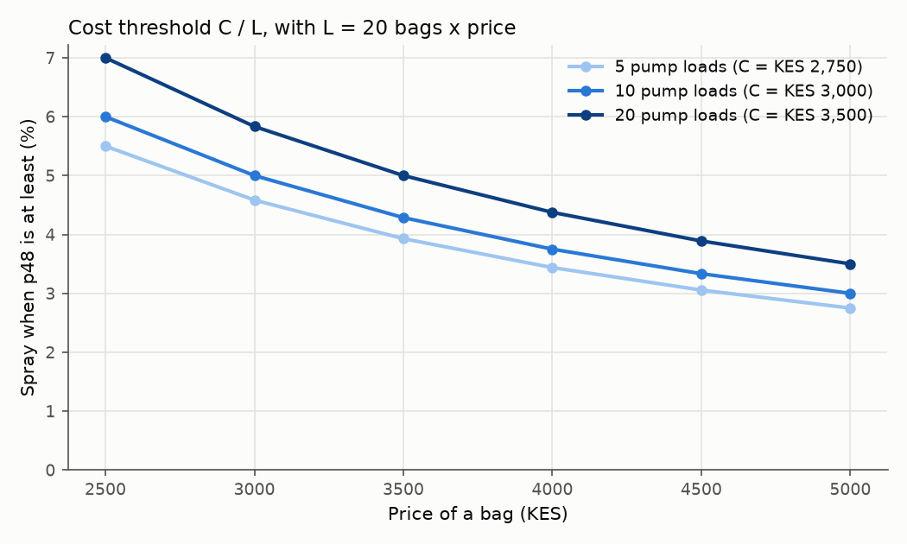
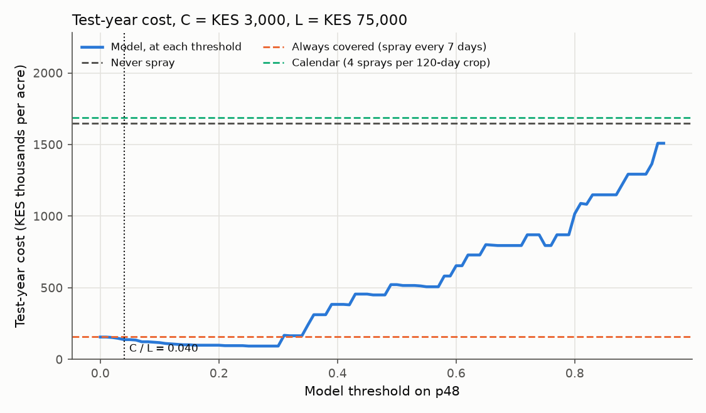

# Cost-asymmetric alert threshold

Generated by `ml/cost_threshold.py`. When is a spray worth it, given the farmer's costs?

- Run: 2026-10-19 08:56 UTC
- Model: `hgb-48h-20261012-data20150102-20261005` (48 h: a Hutton period on D+1 or D+2), test year 2025-10-05 to 2026-10-04 (365 days, 66 Hutton-period days in 22 spells, 0 days unknown, 0 days with no forecast).

## Costs (KES per acre)

- Spray: C = chemical 2,500 + labour 50 × pump loads. Pump loads per acre are not known yet, so three values are shown: 5 loads → C = 2,750, 10 loads → C = 3,000, 20 loads → C = 3,500.
- Missed blight: L = 20 bags × price, KES 2,500 to 5,000 a bag → L = 50,000 to 100,000.

## The threshold

Spraying costs C whatever happens; not spraying costs L if blight weather comes. With a calibrated probability p, spraying is worth it when p × L > C, so the threshold is C / L. As C_FP / (C_FP + C_FN), the costs are regrets: C_FP = C (sprayed for nothing) and C_FN = L − C (a miss loses L, but the right call would still have cost C). Taking C_FN = L instead gives C / (C + L), shown for comparison.

| Price per bag | L | C / L, 5 loads | C / L, 10 loads | C / L, 20 loads | C / (C + L), 10 loads |
|---|---|---|---|---|---|
| 2,500 | 50,000 | 0.055 | 0.060 | 0.070 | 0.057 |
| 3,000 | 60,000 | 0.046 | 0.050 | 0.058 | 0.048 |
| 3,500 | 70,000 | 0.039 | 0.043 | 0.050 | 0.041 |
| 4,000 | 80,000 | 0.034 | 0.037 | 0.044 | 0.036 |
| 4,500 | 90,000 | 0.031 | 0.033 | 0.039 | 0.032 |
| 5,000 | 100,000 | 0.028 | 0.030 | 0.035 | 0.029 |

## The policies on the test year (10 pump loads, C = KES 3,000)

Each spray protects the crop for 7 days. A spell of consecutive Hutton-period days with any day uncovered is one missed infection, costing L once.

| Policy | Sprays | Missed infections | Cost at KES 2,500/bag | Cost at KES 3,750/bag | Cost at KES 5,000/bag |
|---|---|---|---|---|---|
| Never spray | 0 | 22 | 1,100,000 | 1,650,000 | 2,200,000 |
| Always covered (spray every 7 days) | 53 | 0 | 159,000 | 159,000 | 159,000 |
| Calendar (4 sprays per 120-day crop) | 13 | 22 | 1,139,000 | 1,689,000 | 2,239,000 |
| Model at the cost threshold C / L (0.060 / 0.040 / 0.030) | 45 / 46 / 49 | 0 | 135,000 | 138,000 | 147,000 |
| Model at its F1 threshold (0.27) | 31 | 0 | 93,000 | 93,000 | 93,000 |

## Other pump-load settings (cost at the middle price)

| Pump loads | C | C / L | Never spray | Always covered (spray every 7 days) | Calendar (4 sprays per 120-day crop) | Model at the cost threshold C / L | Model at its F1 threshold |
|---|---|---|---|---|---|---|---|
| 5 | 2,750 | 0.037 | 1,650,000 | 145,750 | 1,685,750 | 129,250 | 85,250 |
| 10 | 3,000 | 0.040 | 1,650,000 | 159,000 | 1,689,000 | 138,000 | 93,000 |
| 20 | 3,500 | 0.047 | 1,650,000 | 185,500 | 1,695,500 | 161,000 | 108,500 |

## What this shows

- Losing the crop costs 17 to 33 times as much as one spray, so the cost threshold is low: spray once the chance of a Hutton period in the next 48 h reaches 3.0 % (KES 5,000 a bag) to 6.0 % (KES 2,500). The F1 threshold (0.27) treats a false alarm and a miss as equally bad, which the farmer's costs say they are not.
- At the middle price, the model at its cost threshold costs KES 138,000 over the test year, against KES 159,000 for the best fixed policy (always covered: spray every 7 days).
- But C / L is not the cheapest threshold here. Played through the test year, the cheapest is 0.25 (KES 93,000): one spray covers a week, so spraying at every small chance mostly renews cover that was not needed, and C / L (which prices a single one-day decision) does not see that. Every threshold from 0.14 to 0.30 costs within 10 % of the cheapest, and the F1 threshold (0.27) lands in that range by coincidence, not by design.
- The model rarely misses a spell at any low threshold because a Hutton period needs a Hutton day first, and the model has already seen that day when it decides. The calendar's sprays touch 4 of the 22 spells but cover only 0 of them completely; it is not tied to the weather, so it is little better than never spraying.

## Assumptions (state these with the numbers)

- **Weather, not disease.** A Hutton period stands in for an infection that costs L if the crop is unprotected. Not every Hutton period causes blight, so L per spell overstates misses where inoculum is absent; the farmer's symptom reports (`symptom_reports`) are the data that can calibrate this.
- **A spray fully protects for 7 days** and nothing protects after that. Rain wash-off and systemic products change this.
- **The calendar** assumes year-round planting (the farmer's answers suggest he plants all year): 4 evenly spaced sprays per 120-day crop, crops back to back.
- **C / L assumes a calibrated probability** and a single decision. With cover lasting a week, one spray answers several days, so the cheapest threshold on the test year can differ from C / L; the cost curve shows by how much.
- **One test year**, with its own weather; a wetter or drier year moves every number.
