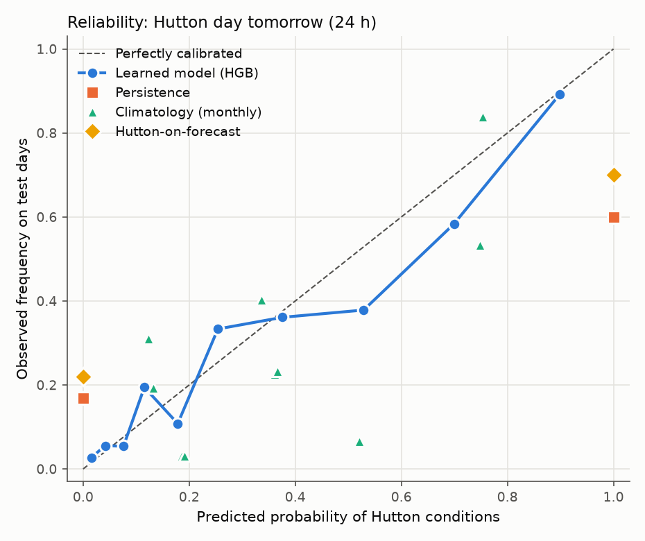
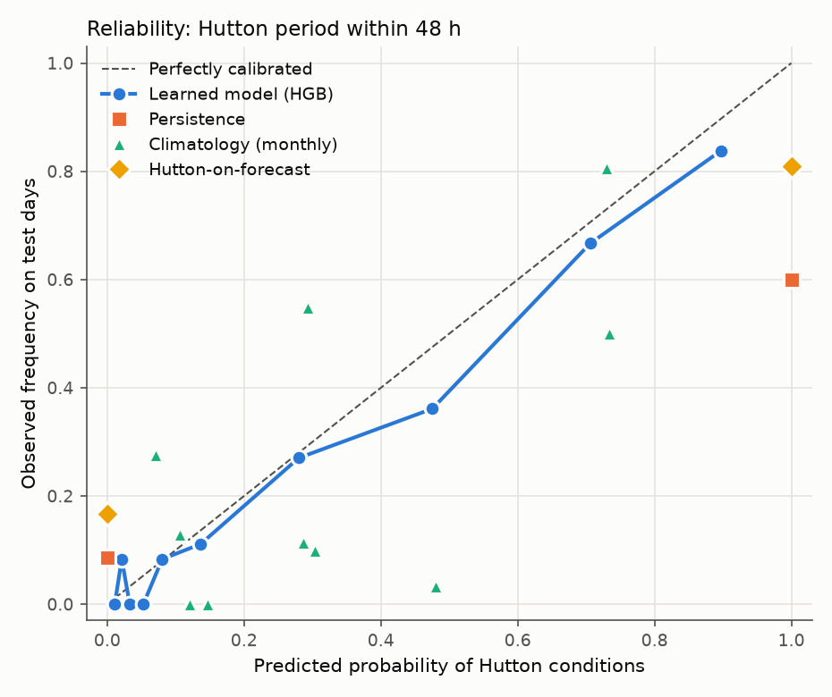
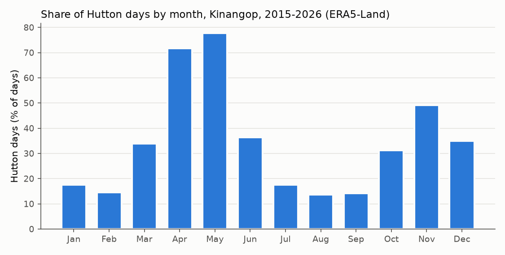

# Learned risk model: evaluation on the held-out test year

Generated by `ml/eval_risk.py`. Models trained by `ml/train_risk.py`; features and targets from `ml/build_features.py`; Hutton days from `backend/hutton.py`.

## Set-up

- **Data:** ERA5-Land reanalysis (Open-Meteo archive API, `models=era5_land`, 0.1°, about 9 km) at the farm (−0.70, 36.60), hourly, 2015-01-02 to 2026-10-05. The model is pinned on purpose: the API's default serves ECMWF IFS forecast data here for recent years, identical to the historical-forecast series, which would have scored the forecast baseline against itself.
- **Targets** for each local day D: `y24` = D+1 is a Hutton day; `y48` = a Hutton period is flagged on D+1 or D+2. Days whose target is unknown are dropped, never counted as negatives.
- **Features** use only data up to the end of day D. `backend/tests/test_build_features.py` changes or deletes every hour after D and checks that no feature for D moves (and it catches a planted look-ahead lag and a centred rolling window).
- **Time-ordered split, never shuffled:** train 2015-01-02 to 2024-10-02, validation 2024-10-05 to 2025-10-02, test 2025-10-05 to 2026-10-04. Two days at each boundary are embargoed because their targets fall in the next split.
- **Tuning** (48-setting grid, PR-AUC) and the **decision threshold** (best F1) were chosen on validation only; the model was then refit on train + validation and scored once on test.

## 24 h: will tomorrow be a Hutton day?

Test days: 365; scored on the 365 days where every method has a prediction. Positives: 109 (base rate 29.9%). Coverage: Learned model (HGB) 100%, Persistence 100%, Climatology (monthly) 100%, Hutton-on-forecast 100%.

| Method | Threshold | Precision | Recall | F1 | F1 @0.5 | PR-AUC | Brier |
|---|---|---|---|---|---|---|---|
| Learned model (HGB) | 0.20 (val) | 0.503 | 0.862 | **0.635** | 0.641 | 0.730 | 0.143 |
| Persistence | 0/1 | 0.600 | 0.606 | **0.603** | 0.603 | 0.481 | 0.238 |
| Climatology (monthly) | 0.19 (val) | 0.343 | 0.771 | **0.475** | 0.440 | 0.520 | 0.195 |
| Hutton-on-forecast | 0/1 | 0.700 | 0.385 | **0.497** | 0.497 | 0.453 | 0.233 |

95 % block-bootstrap intervals (14-day blocks, 1,000 resamples):

| Method | F1 | PR-AUC | Brier | Learned − this: F1 | Learned − this: PR-AUC | Learned − this: Brier (negative = learned better) |
|---|---|---|---|---|---|---|
| Learned model (HGB) | [0.515, 0.746] | [0.562, 0.852] | [0.109, 0.175] |  |  |  |
| Persistence | [0.479, 0.719] | [0.334, 0.622] | [0.175, 0.301] | [-0.031, +0.096] | [+0.176, +0.293] ✱ | [-0.130, -0.060] ✱ |
| Climatology (monthly) | [0.344, 0.623] | [0.293, 0.705] | [0.152, 0.243] | [+0.079, +0.248] ✱ | [+0.099, +0.336] ✱ | [-0.086, -0.021] ✱ |
| Hutton-on-forecast | [0.342, 0.605] | [0.306, 0.586] | [0.170, 0.323] | [+0.024, +0.279] ✱ | [+0.160, +0.368] ✱ | [-0.164, -0.039] ✱ |

Model `hgb-24h-20261012-data20150102-20261005`: {'learning_rate': 0.05, 'max_leaf_nodes': 15, 'min_samples_leaf': 60, 'l2_regularization': 0.0, 'max_iter': 100}. Validation PR-AUC 0.794, F1 0.752 at the chosen threshold (validation base rate 37.7%).

✱ = the interval excludes 0: a clear difference on this test year.

## 48 h: will a Hutton period be flagged on D+1 or D+2?

Test days: 364; scored on the 364 days where every method has a prediction. Positives: 88 (base rate 24.2%). Coverage: Learned model (HGB) 100%, Persistence 100%, Climatology (monthly) 100%, Hutton-on-forecast 100%.

| Method | Threshold | Precision | Recall | F1 | F1 @0.5 | PR-AUC | Brier |
|---|---|---|---|---|---|---|---|
| Learned model (HGB) | 0.27 (val) | 0.576 | 0.864 | **0.691** | 0.655 | 0.761 | 0.106 |
| Persistence | 0/1 | 0.600 | 0.750 | **0.667** | 0.667 | 0.510 | 0.181 |
| Climatology (monthly) | 0.16 (val) | 0.319 | 0.773 | **0.452** | 0.537 | 0.447 | 0.169 |
| Hutton-on-forecast | 0/1 | 0.810 | 0.386 | **0.523** | 0.523 | 0.461 | 0.170 |

95 % block-bootstrap intervals (14-day blocks, 1,000 resamples):

| Method | F1 | PR-AUC | Brier | Learned − this: F1 | Learned − this: PR-AUC | Learned − this: Brier (negative = learned better) |
|---|---|---|---|---|---|---|
| Learned model (HGB) | [0.552, 0.792] | [0.578, 0.870] | [0.073, 0.140] |  |  |  |
| Persistence | [0.553, 0.756] | [0.366, 0.634] | [0.129, 0.228] | [-0.033, +0.074] | [+0.174, +0.310] ✱ | [-0.100, -0.049] ✱ |
| Climatology (monthly) | [0.283, 0.620] | [0.219, 0.672] | [0.121, 0.219] | [+0.137, +0.328] ✱ | [+0.145, +0.439] ✱ | [-0.099, -0.031] ✱ |
| Hutton-on-forecast | [0.314, 0.657] | [0.282, 0.596] | [0.102, 0.258] | [+0.013, +0.369] ✱ | [+0.156, +0.445] ✱ | [-0.136, -0.011] ✱ |

Model `hgb-48h-20261012-data20150102-20261005`: {'learning_rate': 0.05, 'max_leaf_nodes': 15, 'min_samples_leaf': 60, 'l2_regularization': 1.0, 'max_iter': 100}. Validation PR-AUC 0.800, F1 0.749 at the chosen threshold (validation base rate 34.4%).

✱ = the interval excludes 0: a clear difference on this test year.

## Base rate of Hutton days by month

| Month | Days | Hutton days | y24 positive | y48 positive | Test year | Near-constant? |
|---|---|---|---|---|---|---|
| January | 371 | 17.5% | 17.3% | 13.5% | 6.5% |  |
| February | 339 | 14.5% | 13.9% | 8.6% | 28.6% |  |
| March | 372 | 33.9% | 35.2% | 31.5% | 58.1% |  |
| April | 360 | 71.7% | 73.1% | 71.4% | 50.0% |  |
| May | 372 | 77.7% | 76.1% | 73.7% | 83.9% |  |
| June | 360 | 36.4% | 35.6% | 28.6% | 26.7% |  |
| July | 372 | 17.5% | 17.7% | 11.0% | 3.2% |  |
| August | 372 | 13.7% | 13.7% | 10.8% | 19.4% |  |
| September | 360 | 14.2% | 13.9% | 8.9% | 33.3% |  |
| October | 346 | 31.2% | 33.0% | 26.7% | 22.6% |  |
| November | 330 | 49.1% | 47.9% | 43.9% | 10.0% |  |
| December | 341 | 34.9% | 34.9% | 27.3% | 19.4% |  |

## Findings

- **No month is near-constant** (none under 3% or over 97% Hutton days), but the season dominates: May 78% and April 72% of days, against August 14%, September 14%, February 14%. The test year also differed from the long-run pattern month by month (last column of the table), which is why climatology does poorly.
- **24 h:** learned F1 0.635 vs the best baseline (Persistence) 0.603; on the bootstrap the learned model is not distinguishable from it (F1 gap interval [-0.031, +0.096]). Brier: learned 0.143, climatology 0.195.
- **48 h:** learned F1 0.691 vs the best baseline (Persistence) 0.667; on the bootstrap the learned model is not distinguishable from it (F1 gap interval [-0.033, +0.074]). Brier: learned 0.106, climatology 0.169.
- **Probabilities, not just yes/no.** Fusion uses the risk as a number r, so calibration matters as much as F1. Learned Brier score: 24 h 0.143 (persistence 0.238, climatology 0.195); 48 h 0.106 (persistence 0.181, climatology 0.169). Persistence and the forecast can only ever say 0 or 1.
- **The answer depends on the weather product.** Over the same days (2022-01-02 to 2026-10-05, 1738 days), ERA5-Land gives 33% Hutton days and the IFS forecast series 15%. Part of Hutton-on-forecast's low recall is this systematic difference between products, not only forecast error, and it is the strongest argument for measuring at the plot itself with the sensor node.
- Hutton-on-forecast coverage: historical_forecast data runs 2022-01-01 to 2026-10-12; it covers 100% of the test days (2025-10-05 to 2026-10-04).

## Caveats

- **The Hutton-on-forecast baseline is optimistic.** Open-Meteo's historical-forecast series is stitched from the first hours of successive model runs, so its "D+1" values come from runs issued during D+1, not from a forecast issued at the end of D. A true fixed-lead forecast (Previous Runs API) would do worse. Treat it as an upper bound for forecast-based Hutton.
- **Targets are reanalysis, not the plot.** ERA5-Land is a ~9 km grid; the sensor under the canopy is more humid. Predictions from sensor data are a domain shift until sensor history exists to compare.
- **One test year** (~365 days, few positives) gives wide intervals; read differences through the bootstrap table, not the point estimates alone.
- **PR-AUC for persistence and forecast** is computed from 0/1 predictions, so it is a single operating point, not a ranking; compare those two on precision, recall and F1.
