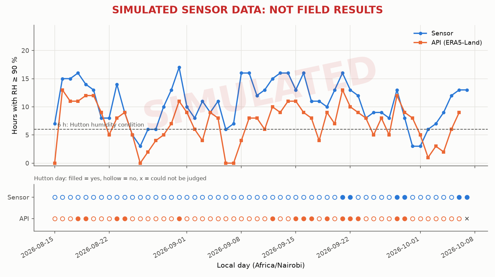

# Sensor vs API: Hutton days at the plot

> # ⚠️ SIMULATED SENSOR DATA: NOT FIELD RESULTS
>
> The 'sensor' series is tools/simulate_node.py replaying Open-Meteo weather into the ingest API, with a +4 % RH under-canopy offset, small noise and simulated outages. It shows how the simulator differs from the archive, NOT how a real sensor would. As of 19 Oct 2026 the stored readings had been replayed from the weather files as they were before the archive was pinned to ERA5-Land (12 Oct 2026), which were ECMWF IFS data, so this compares IFS + offset against ERA5-Land.

Generated by `ml/compare_sensor_vs_api.py`. The same Hutton rule (`backend/hutton.py`) on two data sources at the same location.

- Node: `NODE-E30CEA4721CE` (Kinangop plot)
- Sensor: the node's readings (`sensor_readings`)
- API: Open-Meteo ERA5-Land archive at the node's coordinates (`weather_readings`, source `archive`)
- Days: 2026-08-15 to 2026-10-07 (54 local days, Africa/Nairobi)
- Judged days (20 of 24 hours): sensor 54, API 53. Too few hours: sensor 0, API 1. No data: sensor 0, API 0.
- Run: 2026-10-19 08:54 UTC

## Hutton days

| | API: yes | API: no |
|---|---|---|
| **Sensor: yes** | 4 (both true) | 1 (sensor only) |
| **Sensor: no** | 11 (API only) | 37 (both false) |

Days judged by both: 53 · agreement 0.774 · Cohen's kappa 0.301 · days either source could not judge: 1

On the 11 API-only Hutton days, the sensor failed on minimum temperature (< 10 °C) on 11, on humid hours (< 6) on 0, and on both on 0.
On the 1 sensor-only Hutton day, the API failed on minimum temperature (< 10 °C) on 1, on humid hours (< 6) on 0, and on both on 0.

## Hutton periods (two Hutton days running, flagged on the second)

| | API: yes | API: no |
|---|---|---|
| **Sensor: yes** | 2 (both true) | 0 (sensor only) |
| **Sensor: no** | 5 (API only) | 45 (both false) |

Days judged by both: 52 · agreement 0.904 · Cohen's kappa 0.409 · days either source could not judge: 2

## Humid hours per day (RH ≥ 90 %), sensor minus API

| Days | Mean | SD | Median | Mean absolute | Min | Max |
|---|---|---|---|---|---|---|
| 53 | +3.60 h | 3.03 h | +4.0 h | 3.94 h | -5 h | +12 h |

Mean humid hours per day: sensor 10.7, API 7.1. The sensor counted more humid hours on 45 days, fewer on 4, the same on 4. Mean difference in the daily minimum temperature: -0.51 °C.

## How to read this

- **Kappa** corrects the raw agreement for chance: 1 is perfect agreement, 0 is no better than two sources that say yes at the same rates independently. It is undefined (n/a) when both sources give the same single answer on every day.
- A day either source could not judge is counted apart, never as "not a Hutton day".
- Sensor-only days are where the plot looked more favourable to blight than the regional archive; the API (about 9 km grid, 2 m height) cannot see the wetter air inside a canopy.

> # ⚠️ SIMULATED SENSOR DATA: NOT FIELD RESULTS
>
> The 'sensor' series is tools/simulate_node.py replaying Open-Meteo weather into the ingest API, with a +4 % RH under-canopy offset, small noise and simulated outages. It shows how the simulator differs from the archive, NOT how a real sensor would. As of 19 Oct 2026 the stored readings had been replayed from the weather files as they were before the archive was pinned to ERA5-Land (12 Oct 2026), which were ECMWF IFS data, so this compares IFS + offset against ERA5-Land.
